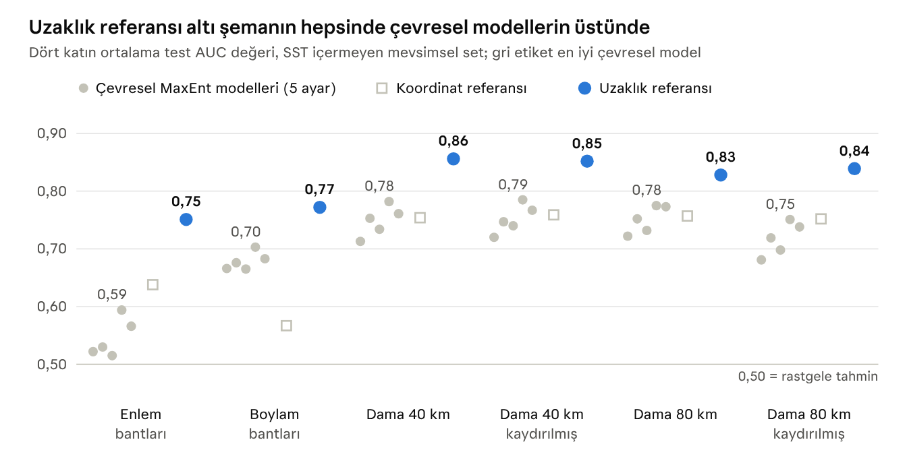
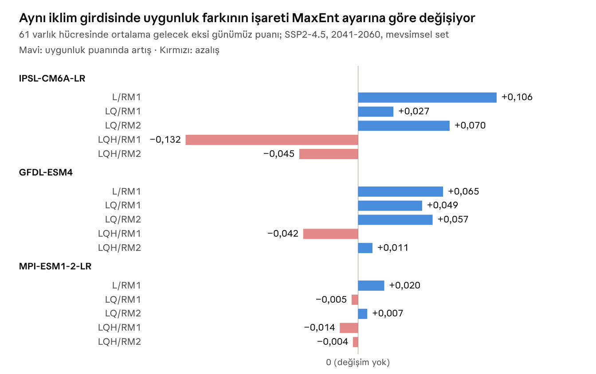

# Adélie Pengueni Dağılım Modelleri Geleceği Ne Kadar Güvenilir Öngörüyor? Marguerite Körfezi'nde MaxEnt Projeksiyonlarının Coğrafi Referanslarla Sınanması

TÜBİTAK 2204-A Proje Raporu · 15 Kasım 2026

## Özet

Tür dağılım modelleri, iklim değişikliğinin penguen kolonilerine etkisini öngörmek için yaygın olarak kullanılmaktadır. Ancak bir modelin geleceğe aktarılabilmesi için önce bugünkü dağılımı coğrafi yakınlıktan daha iyi açıklaması gerekir. Bu projede, Batı Antarktika Yarımadası'ndaki Marguerite Körfezi çevresinde Adélie pengueni (*Pygoscelis adeliae*) için kurulan MaxEnt modellerinin bu koşulu sağlayıp sağlamadığı sınanmıştır. 2000-2025 dönemine ait GBIF kayıtlarından elde edilen 61 varlık hücresi, 0,25° çözünürlüklü 579 kıyı hücresi üzerinde iki değişken seti ve beş MaxEnt ayarıyla modellenmiştir. Her model altı mekânsal bölme şemasında dört katlı çapraz doğrulamayla değerlendirilmiş, toplam 240 eğitim yapılmıştır. Çevresel modellerin şema ortalaması AUC değerleri 0,48-0,80 arasında kalmış; hiçbir şemada, yalnızca en yakın eğitim kaydına uzaklığı kullanan referansı (0,75-0,86) geçememiştir. Üç CMIP6 iklim modeliyle (SSP2-4.5, 2041-2060) yapılan aktarımda, aynı iklim girdisi altında gelecek ile günümüz arasındaki uygunluk farkının işareti MaxEnt ayarına göre değişmiştir (IPSL-CM6A-LR için +0,115 ile -0,318 arası). Bu bulgular, bölgede küçük örneklemle kurulan MaxEnt projeksiyonlarının habitat kaybı ya da kazancı olarak yorumlanamayacağını göstermektedir. Çalışma, gelecek haritası üretmeden önce uygulanabilecek üç adımlı bir güvenilirlik denetimi önermekte ve doğrulanmış yuva sayımlarına dayalı koloni modelini bir sonraki aşama olarak tanımlamaktadır.

**Anahtar kelimeler:** Adélie pengueni, tür dağılım modeli, MaxEnt, mekânsal çapraz doğrulama, model belirsizliği, Marguerite Körfezi

## Amaç

Bu projenin amacı, Marguerite Körfezi çevresinde Adélie pengueni için kurulan MaxEnt tür dağılım modellerinin geleceğe aktarılmaya yetecek kadar güvenilir olup olmadığını sınamaktır. Amaç daha yüksek bir AUC değeri ya da belirli bir habitat kaybı yüzdesi elde etmek değildir; modelin hangi koşulda güvenilir sayılabileceğini ölçülebilir biçimde ortaya koymaktır.

Çalışma iki araştırma sorusuna yanıt arar:

1. Çevresel değişkenlerle kurulan model, türün bulunduğu hücreleri yalnızca coğrafi yakınlığa dayanan basit bir referanstan daha iyi ayırt edebiliyor mu?
2. 2041-2060 dönemine aktarımda öngörülen uygunluk değişiminin yönü, MaxEnt ayarından ve kullanılan iklim modelinden bağımsız mı?

Bu sorulara karşılık gelen hipotezler şunlardır:

- **H1:** Çevresel modellerin mekânsal çapraz doğrulamadaki AUC değeri, en yakın eğitim kaydına uzaklık referansının AUC değerinden yüksektir.
- **H2:** Aynı iklim girdisi altında, farklı MaxEnt ayarları gelecek ile günümüz arasındaki uygunluk farkı için aynı işareti verir.

İki hipotez de doğrulanırsa gelecek haritaları habitat değişimi olarak yorumlanabilir. Biri bile reddedilirse projeksiyonlar ancak hipotez üretme düzeyinde kullanılabilir.

## Giriş

Adélie pengueni (*Pygoscelis adeliae*), Antarktika kıyılarında buzsuz kayalık alanlarda yuva yapan ve çevredeki denizde beslenen bir türdür. Yaşam döngüsü deniz buzuna sıkı biçimde bağlıdır. Batı Antarktika Yarımadası hızlı ısınan bölgelerden biri olduğu için, türün gelecekteki dağılımı iklim değişikliği araştırmalarında sık sorulan bir sorudur. Cimino vd. (2016), türün iklim değişikliğine bölgeden bölgeye farklı yanıt verebileceğini göstermiştir. Marguerite Körfezi bu yarımadanın güney kesiminde yer alır ve Türkiye'nin kutup araştırmalarının yürütüldüğü bölgedir.

Bu tür soruları yanıtlamak için en yaygın araçlardan biri tür dağılım modelleridir. MaxEnt, yalnızca türün görüldüğü noktaları (varlık kayıtlarını) kullanır. Bu noktalardaki çevre koşullarını çalışma alanının genelindeki koşullarla (arka plan) karşılaştırarak her hücre için 0 ile 1 arasında bir uygunluk puanı üretir (Phillips vd., 2006; Elith vd., 2011). Arka plan hücreleri gerçek yokluk değildir; yalnızca alanda hangi koşulların bulunduğunu temsil eder.

Modelin başarısı çoğunlukla AUC ile ölçülür: 0,5 rastgele tahmine, 1 kusursuz ayrıma karşılık gelir. Ancak yüksek bir AUC, modelin ekolojik ilişkiyi öğrendiğini kanıtlamaz. Tür kayıtları genellikle araştırma istasyonlarının çevresinde kümelenir ve komşu hücrelerin iklimi birbirine çok benzer. Bu durumda test noktaları eğitim noktalarının yanına düşer ve model yalnızca konumu ezberleyerek yüksek puan alabilir. Bu sorunu azaltmak için veriyi coğrafi bloklara bölen mekânsal çapraz doğrulama (Roberts vd., 2017) ve modelin yalnızca uzaklığa dayanan bir referansla karşılaştırılması (Hijmans, 2012) önerilmiştir. Model ayarlarının, yani özellik sınıflarının ve düzenlileştirme katsayısının sonuçları belirgin biçimde değiştirebildiği de bilinmektedir (Warren ve Seifert, 2011; Radosavljevic ve Anderson, 2014).

Adélie pengueni için yapılan önceki modelleme çalışmaları kıta ya da yarımada ölçeğindedir. Wang vd. (2026) OBIS kayıtlarıyla SSP5-8.5 senaryosunda 2090-2100 dönemini incelemiş; Gallagher vd. (2025) ise yuva sayımlarını 500 m çözünürlüklü karasal verilerle lojistik regresyonla modellemiştir. Bu çalışmaların hiçbiri, Marguerite Körfezi ölçeğinde bir MaxEnt projeksiyonunun coğrafi referansa ve model ayarına karşı ne kadar dayanıklı olduğunu sınamamıştır.

Bu projenin katkısı yeni bir habitat haritası değildir. Katkı, gelecek haritası üretmeden önce modelin iki somut sınavdan geçirilmesi ve sonucun, olumsuz olsa bile, sayılarla raporlanmasıdır. Bu yaklaşım, benzer küçük örneklemli kutup çalışmaları için uygulanabilir bir denetim adımı sunar.

## Yöntem

Çalışma, açık erişimli verilerle yürütülen bir modelleme ve model denetimi araştırmasıdır. Tüm işlemler Python betikleri ve MaxEnt 3.4.4 yazılımıyla yapılmış; kod, ayarlar ve ara çıktılar proje deposunda saklanmıştır.

### Çalışma alanı ve ızgara

Çalışma alanı Marguerite Körfezi ve çevresidir. Analiz 0,25° çözünürlüklü bir ızgarada yürütülmüştür: hücre merkezleri 66,00-70,50°G ve 64,00-73,00°B arasındadır, ızgara 37 sütun ve 19 satırdan (703 hücre) oluşur. WGS84 elipsoidi üzerinde hesaplanan toplam ızgara alanı 202.682 km²'dir. Bu enlemde bir hücre kuzey-güney yönünde yaklaşık 28 km, doğu-batı yönünde yaklaşık 10 km'dir.

### Tür kayıtları

Varlık kayıtları GBIF'ten indirilmiştir (GBIF.org, 2026). 1001 ham kayıttan koordinat ve tekrar denetimlerinden sonra 704 temiz kayıt kalmıştır. İklim verisi 2000-2025 dönemini kapsadığı için 2026 tarihli 163 kayıt çıkarılmıştır. Aynı hücreye düşen kayıtlardan konum belirsizliği en düşük olan tek kayıt bırakılmış ve arka plan alanı içinde 61 varlık hücresi elde edilmiştir. Bu kayıtlar genel gözlemlerdir; her birinin üreme kolonisi olduğu doğrulanmamıştır.

### Çevresel değişkenler

İklim değişkenleri ERA5 yeniden analizinin 2000-2025 aylık ortalamalarından üretilmiştir (Hersbach vd., 2020). Kaya yüzdesi, SCAR Antarktika Sayısal Veri Tabanı kaya poligonlarının eşit alanlı projeksiyonda hücrelerle kesiştirilmesiyle hesaplanmıştır (Skachkova vd., 2025). Deniz değişkenleri kara hücrelerinde tanımsız olduğundan, bu hücrelere küre üzerindeki en yakın deniz hücresinin değeri atanmıştır.

**Tablo 1.** Modellerde kullanılan değişkenler

| Değişken | Kaynak | Tanım ve birim | Kullanıldığı set |
| --- | --- | --- | --- |
| Kaya yüzdesi | SCAR ADD v7.11 | Hücre alanının buzsuz kaya ile kaplı kısmı, % | Her iki set |
| BIO18 | ERA5 | En sıcak ardışık üç ayın toplam yağışı, mm | Her iki set |
| Üreme dönemi deniz buzu | ERA5 | Kasım-Mart aylık ortalamalarının ortalaması, % | Mevsimsel set |
| Yıllık deniz buzu | ERA5 | On iki ayın ortalaması, % | Yıllık set |
| Yıllık deniz yüzeyi sıcaklığı (SST) | ERA5 | On iki ayın ortalaması, °C | Yıllık set |

Veri denetiminde yıllık SST katmanında deniz suyunun donma noktasının altında değerler saptanmıştır (Bulgular). Bu nedenle SST içermeyen mevsimsel set ana analiz, SST içeren yıllık set duyarlılık analizi olarak ele alınmıştır. Değişkenler arasındaki çoklu doğrusal bağlantı varyans şişirme faktörü (VIF) ile denetlenmiştir.

### Arka plan

Arka plan olarak, penguenlerin gözlenebileceği kıyı kuşağını temsil eden 579 hücre kullanılmıştır. Bu küme, en az yarısı açık deniz olan hücreler ile kaya içeren ve buz sahanlığı oranı %50'nin altında kalan kara hücrelerinden oluşur. Varlık hücreleri arka planın içinde tutulmuştur.

### MaxEnt ayarları

MaxEnt'te iki ayar modelin esnekliğini belirler. Özellik sınıfı, değişken ile uygunluk arasındaki ilişkinin biçimini tanımlar: doğrusal (L), ikinci dereceden (Q) ve parçalı doğrusal, yani menteşe (H). Düzenlileştirme katsayısı (RM) büyüdükçe model sadeleşir. Otomatik seçime güvenmek yerine beş ayar önceden sabitlenmiştir: L/RM1, LQ/RM1, LQ/RM2, LQH/RM1 ve LQH/RM2. Çıktı biçimi cloglog'dur. Ayarlar test sonuçlarına bakılarak seçilmemiş, bu nedenle hiçbir ayar "en iyi model" ilan edilmemiştir.

### Mekânsal çapraz doğrulama ve coğrafi referanslar

Her model altı farklı mekânsal bölme şemasıyla, dört katlı çapraz doğrulamayla sınanmıştır: enlem bantları, boylam bantları ve kenarı 40 km ile 80 km olan, başlangıcı yarım blok kaydırılmış ve kaydırılmamış dama tahtası blokları. Bloklar Antarktika kutupsal stereografik projeksiyonunda (EPSG:3031) kilometre cinsinden tanımlanmıştır. Her katta test bölgesinin varlık ve arka plan hücreleri eğitimden tamamen çıkarılmış, değerlendirme yalnızca o bölgede yapılmıştır. Kat başına test varlık sayısı 11 ile 22 arasındadır. İki değişken seti, beş ayar, altı şema ve dört kat toplam 240 eğitim eder.

Aynı katlarda iki coğrafi referans değerlendirilmiştir:

- **Uzaklık referansı:** Bir hücrenin puanı, en yakın eğitim varlık hücresine uzaklığının negatifidir. Hiçbir çevresel bilgi kullanmaz (Hijmans, 2012).
- **Koordinat referansı:** Yalnızca hücrenin konum koordinatlarıyla eğitilen düzenlileştirilmiş lojistik regresyondur.

Başarım üç ölçütle değerlendirilmiştir: AUC; eğitim varlık puanlarının 10. yüzdeliği eşik alındığında test varlıklarının kaçırılma (omission) oranı; ve on eşit aralıklı Boyce indeksi (Hirzel vd., 2006). Ayrıca Hijmans'ın (2012) önerdiği kalibre AUC hesaplanmıştır:

```latex
\mathrm{AUC}_{kalibre} = \mathrm{AUC}_{model} + 0{,}5 - \max(0{,}5;\ \mathrm{AUC}_{uzaklık})
```

Kalibre AUC'nin 0,5'in üstünde olması, modelin coğrafi yakınlığın ötesinde bilgi taşıdığını gösterir.

### İklim projeksiyonu

Gelecek koşulları için CMIP6 kapsamındaki üç küresel iklim modeli kullanılmıştır: IPSL-CM6A-LR, GFDL-ESM4 ve MPI-ESM1-2-LR (Eyring vd., 2016). Senaryo orta düzey emisyonlu SSP2-4.5, dönem 2041-2060'tır (O'Neill vd., 2016). Her modelden tek bir üye alınmıştır. Modellerin sistematik hatalarını azaltmak için delta yöntemi uygulanmıştır: her ay için modelin 2041-2060 ortalaması ile kendi 2000-2025 ortalaması arasındaki fark ERA5 değerine eklenmiş, deniz buzu %0-100 aralığına sınırlandırılmıştır. Modelin 2000-2025 referansı, tarihsel deneyin 2000-2014 yılları ile SSP2-4.5 deneyinin 2015-2025 yılları birleştirilerek oluşturulmuştur. Kaya yüzdesi gelecekte sabit tutulmuştur.

Tüm varlık hücreleriyle eğitilen 30 model (iki set, beş ayar, üç iklim modeli) gelecek katmanlarına aktarılmıştır. Sonuç, 61 varlık hücresindeki ortalama gelecek eksi günümüz puan farkı olarak özetlenmiştir. Aktarımda eğitim aralığının dışına çıkan değerler sınırlandırılmış (clamping), eğitim verisinde görülmeyen koşullara düşen hücreler çok değişkenli çevresel benzerlik yüzeyi (MESS) ile belirlenmiştir (Elith vd., 2010).

## Proje İş-Zaman Çizelgesi

**Tablo 2.** İş paketlerinin 2026 yılındaki haftalara dağılımı

| İş paketi | Ekim 3. hafta | Ekim 4. hafta | Kasım 1. hafta | Kasım 2. hafta |
| --- | --- | --- | --- | --- |
| Literatür taraması ve araştırma sorusunun belirlenmesi | X | X |  |  |
| ERA5 iklim katmanlarının ve kaya yüzdesinin üretilmesi | X |  |  |  |
| GBIF kayıtlarının indirilmesi ve temizlenmesi | X |  |  |  |
| İlk MaxEnt denemeleri ve haritalar | X | X |  |  |
| Mekânsal çapraz doğrulama ve CMIP6 verilerinin hazırlanması |  |  | X |  |
| Beş ayar, altı şema ve coğrafi referanslarla yeniden analiz |  |  |  | X |
| Üç iklim modeliyle gelecek aktarımı ve duyarlılık analizi |  |  |  | X |
| Rapor yazımı |  |  | X | X |

## Bulgular

### Veri denetimi

Temizlenen 704 GBIF kaydının 403'ü kara, 301'i deniz hücrelerine düşmektedir; kayıtların hiçbiri mevcut üst veriyle üreme kaydı olarak doğrulanamamıştır. 2026 tarihli 163 kayıt çıkarıldıktan sonra 61 varlık hücresi kalmıştır. Karşılaştırma için incelenen MAPPPD yuva sayımı veri tabanında aynı alanda 2000-2025 dönemine ait 45 pozitif sayım, 19 yerleşim ve yalnızca 14 hücre bulunmaktadır (Oceanites, 2026). Doğrulanmış koloni verisi bu alanda tek başına bir model kurmaya yetmemektedir.

ERA5 yıllık SST katmanında, 339 deniz hücresinin altısında -2 °C'nin altında değer saptanmıştır; en düşük değer -2,42 °C'dir. Deniz suyu yaklaşık -1,9 °C'de donduğu için bu değerler fiziksel olarak beklenmez. Kaynağın birimi ve kimliği doğrulanmış, ancak uç değerlerin nedeni açıklanamamıştır. Bu yüzden SST içermeyen mevsimsel set ana analiz olarak sunulmaktadır.

**Tablo 3.** Yıllık değişken setinin iki farklı alandaki VIF değerleri

| Değişken | Kıyı arka planı (579 hücre) | Yalnız deniz hücreleri (325 hücre) |
| --- | --- | --- |
| BIO18 | 2,04 | 1,76 |
| Yıllık deniz buzu | 2,80 | 5,64 |
| Kaya yüzdesi | 1,16 | 1,24 |
| Yıllık SST | 2,01 | 5,25 |

Modelin kurulduğu kıyı arka planında tüm VIF değerleri 5'in altındadır. Yalnız deniz hücrelerinde ise buz ve SST 5'i aşmaktadır; yani çoklu doğrusal bağlantı sonucu, hesabın yapıldığı alana bağlıdır.

### Birinci soru: Çevresel model coğrafi referansı geçiyor mu?

Geçmiyor. Altı bölme şemasının hepsinde, beş MaxEnt ayarının ortalama test AUC değeri uzaklık referansının altında kalmıştır (Şekil 1).



*Şekil 1. Altı mekânsal bölme şemasında çevresel modellerin ve iki coğrafi referansın ortalama test AUC değerleri (61 varlık hücresi, 579 arka plan hücresi, mevsimsel set).*

En iyi çevresel model ile uzaklık referansı arasındaki fark şemaya göre 0,05 ile 0,16 AUC puanı arasındadır. Enlem bantlarında, yani modelin kuzeyden güneye aktarılması gereken en zor sınavda, doğrusal ve ikinci dereceden modeller rastgele tahmin düzeyinde kalmıştır (0,52-0,53). SST içeren yıllık sette sonuç aynıdır: çevresel modeller 0,48-0,80, uzaklık referansı 0,75-0,86 aralığındadır.

Kat düzeyinde bakıldığında, 240 eğitimin yalnızca 25'inde çevresel model uzaklık referansından yüksek AUC vermiştir (mevsimsel sette 120'de 14, yıllık sette 120'de 11). Kalibre AUC değerleri bütün ayar ve şemalarda 0,23 ile 0,45 arasındadır; hiçbiri 0,5 eşiğine ulaşmamıştır. Yalnızca koordinat kullanan referansın ortalama AUC değeri (0,70) de çevresel modellerle (0,67-0,73) aynı düzeydedir.

**Tablo 4.** Mevsimsel sette ayarlara göre ortalama başarım (24 kat)

| Ayar | AUC | Kalibre AUC | Omission oranı | Boyce indeksi |
| --- | --- | --- | --- | --- |
| L/RM1 | 0,67 | 0,35 | 0,10 | 0,38 |
| LQ/RM1 | 0,70 | 0,38 | 0,11 | 0,44 |
| LQ/RM2 | 0,68 | 0,36 | 0,10 | 0,43 |
| LQH/RM1 | 0,73 | 0,42 | 0,17 | 0,51 |
| LQH/RM2 | 0,72 | 0,40 | 0,15 | 0,44 |

Omission oranının beklenen değeri 0,10'dur. En esnek ayar olan LQH/RM1 en yüksek AUC'yi verirken test varlıklarının %17'sini kaçırmıştır; yıllık sette bu oran %23'e çıkmaktadır. Bu, esnek modelin eğitim verisine aşırı uyum gösterdiğine işaret eder. Yıllık sette LQH/RM1 modeli 61 varlık hücresine karşılık 35 parametre kullanmıştır. Sonuç olarak H1 reddedilmiştir.

### İkinci soru: Öngörülen değişimin yönü ayardan bağımsız mı?

Bağımsız değil. Üç iklim modelinin her birinde, beş MaxEnt ayarı hem artış hem azalış öngörmüştür (Şekil 2).



*Şekil 2. Üç iklim modeli ve beş MaxEnt ayarı için 61 varlık hücresindeki ortalama uygunluk puanı farkı (tüm verilerle eğitilen modeller, clamping açık, cloglog çıktı).*

Doğrusal model (L/RM1) üç iklim modelinde de artış, en esnek model (LQH/RM1) üçünde de azalış öngörmektedir. Yani sonucun işaretini iklim modeli değil, MaxEnt ayarı belirlemektedir. SST içeren yıllık sette ayrışma daha da büyüktür: IPSL-CM6A-LR girdisiyle L/RM1 +0,115, LQH/RM1 -0,318 vermiştir.

Aynı ayrışma alan ölçüsünde de görülmektedir. Yıllık sette ve IPSL-CM6A-LR girdisiyle, eşik üstü uygun alan L/RM1 modelinde 107.402 km²'den 143.695 km²'ye çıkarken (+%34), LQH/RM1 modelinde 69.418 km²'den 62.679 km²'ye düşmektedir (-%10). Önceden tek bir ayar seçilmiş olsaydı, aynı veriden "habitat genişliyor" ya da "habitat daralıyor" sonucu çıkarılabilirdi. Sonuç olarak H2 reddedilmiştir.

### Aktarım koşullarının denetimi

Mekânsal çapraz doğrulamada test bölgesi hücrelerinin ortalama %8'i (mevsimsel set) ile %9'u (yıllık set), eğitim bölgesinde hiç görülmeyen çevre koşullarına düşmektedir. Gelecek aktarımında clamping işleminin etkisi sete göre değişmektedir. IPSL-CM6A-LR girdisiyle clamping, yıllık sette 579 hücrenin 61-232'sinde puan farkını 0,05'ten fazla değiştirmiş; mevsimsel sette bu sayı 11-60 hücrede kalmıştır.

İklim modellerinin bölgedeki deniz buzunu ne kadar iyi temsil ettiği de sınanmıştır (Tablo 5).

**Tablo 5.** İklim modellerinin 2000-2025 aylık deniz buzu ortalamalarının ERA5'e göre farkı (339 deniz hücresi)

| İklim modeli | Ortalama sapma (yüzde puanı) | RMSE (yüzde puanı) |
| --- | --- | --- |
| IPSL-CM6A-LR | +10,1 | 22,1 |
| GFDL-ESM4 | +27,9 | 35,4 |
| MPI-ESM1-2-LR | -12,5 | 21,3 |

Modellerin bölgesel buz hataları büyüktür; GFDL-ESM4 buzu ortalama 28 yüzde puanı fazla göstermektedir. Delta yöntemi bu sapmanın bir kısmını giderir, ancak %0-100 ile sınırlı bir değişkende sapmalı bir modelin farkını gözlenen değere eklemek yeni bir belirsizlik kaynağıdır.

## Sonuç ve Tartışma

İki hipotez de reddedilmiştir. Marguerite Körfezi'nde 61 varlık hücresiyle kurulan MaxEnt modelleri, türün bulunduğu hücreleri coğrafi yakınlıktan daha iyi ayırt edememiş; geleceğe aktarıldıklarında ise değişimin yönü bile model ayarına bağlı kalmıştır. Bu nedenle bu modellerden üretilen 2041-2060 haritaları habitat kaybı ya da kazancı olarak yorumlanamaz.

**Uzaklık referansı neden üstün?** Üç neden öne çıkmaktadır. Birincisi, gözlemler araştırma istasyonlarının ve gemi rotalarının çevresinde kümelenmektedir; bir kaydın yanındaki hücrede başka bir kayıt bulunma olasılığı çevre koşullarından bağımsız olarak yüksektir. İkincisi, ERA5'in gerçek çözünürlüğü yaklaşık 31 km'dir; doğu-batı yönünde 10 km genişliğindeki komşu hücreler neredeyse aynı iklim değerini taşır ve model hücreler arasında ayrım yapacak bilgi bulamaz. Üçüncüsü, modeldeki üç-dört değişken koloni yerini belirleyen yerel etkenleri (kıyı topoğrafyası, derinlik, besin) içermemektedir. Hijmans (2012) bu durumu mekânsal sıralama yanlılığı olarak tanımlamış ve model başarısının uzaklık referansına göre kalibre edilmesini önermiştir. Bu çalışmada kalibre AUC değerlerinin tümü 0,5'in altındadır.

**Esneklik ve aktarılabilirlik.** En esnek ayar (LQH/RM1) en yüksek AUC'yi vermiş, ancak aynı zamanda en yüksek omission oranını ve gelecekte en büyük azalışı üretmiştir. Bu, model karmaşıklığının günümüze uyumu artırırken aktarımı bozabileceğini bildiren çalışmalarla uyumludur (Warren ve Seifert, 2011; Radosavljevic ve Anderson, 2014). Dolayısıyla yalnızca AUC'ye bakılarak seçilen bir modelin projeksiyonu yanıltıcı olabilir. Bu çalışmada hiçbir ayar "doğru model" olarak seçilmemiştir; ayarlar arasındaki farkın kendisi bulgudur.

**Literatürle karşılaştırma.** Cimino vd. (2016) ve Wang vd. (2026) Adélie pengueni için kıta ölçeğinde habitat değişimi öngörmüştür. Bu çalışmanın bulguları o sonuçları doğrulamaz ya da çürütmez; çünkü veri kaynağı, ölçek, dönem ve senaryo farklıdır. Gösterilen şey, yerel ölçekte ve küçük örneklemle aynı yöntemin denetimsiz uygulandığında güvenilir sonuç vermediğidir. Gallagher vd. (2025), yuva sayımları ve 500 m çözünürlüklü karasal verilerle çok daha yüksek başarım bildirmiştir; bu da sorunun türün modellenemez olmasından değil, kullanılan verinin türünden ve çözünürlüğünden kaynaklandığını düşündürmektedir.

**Sınırlılıklar.**

- Varlık kayıtları genel gözlemlerdir; üreme kolonisi oldukları doğrulanmamıştır ve gözlem yanlılığı düzeltilmemiştir.
- Kat başına 11-22 test hücresi düşmektedir; tek tek kat sonuçları kararsızdır. Altı şema aynı 61 hücreyi yeniden kullandığı için bağımsız tekrar sayılmaz.
- Yalnızca iki düzenlileştirme düzeyi (RM 1 ve 2) denenmiştir.
- Her iklim modelinden tek üye ve tek senaryo kullanılmıştır; modellerin iç değişkenliği ölçülmemiştir.
- SST katmanındaki uç değerlerin nedeni çözülmemiştir.
- 0,25° ızgara koloni ölçeğini temsil etmez; kara hücrelerine en yakın deniz hücresinin değeri atanmıştır.

**Sonuç.** Bu çalışma, bir tür dağılım modelinden gelecek haritası üretmeden önce uygulanabilecek üç adımlı bir denetim önermektedir:

1. Modeli mekânsal bloklarla sınamak ve sonucu uzaklık referansıyla karşılaştırmak.
2. Birden fazla özellik sınıfı ve düzenlileştirme ayarıyla projeksiyonun işaretinin değişip değişmediğine bakmak.
3. Aktarımda eğitim aralığı dışına çıkan hücreleri ve clamping etkisini raporlamak.

Marguerite Körfezi'ndeki mevcut model bu denetimin ilk iki adımını geçememiştir. Bu olumsuz sonuç, yöntemin denetlenmeden kullanılması hâlinde aynı veriden zıt ekolojik sonuçlar çıkarılabileceğini gösterdiği için kendi başına bir bulgudur.

## Öneriler

- **Doğrulanmış koloni verisine geçilmesi.** Genel gözlemler yerine MAPPPD pozitif yuva sayımları kullanılmalıdır (Humphries vd., 2017). Yerelde yalnızca 14 hücre bulunduğu için eğitim alanı Antarktika Yarımadası'na genişletilmelidir. Yapılan ön envanter, 60-74°G ve 53-78°B aralığında 85 Adélie yerleşiminin 51 hücreye düştüğünü göstermiştir. Bu model kurulduktan sonra aynı denetim tekrarlanmalıdır.
- **Gözlem yanlılığının ele alınması.** Arka plan, tüm *Pygoscelis* türlerinin sayıldığı hücrelerden seçilerek (hedef grup arka planı) gözlem çabasındaki dengesizlik azaltılabilir (Phillips vd., 2009).
- **Daha geniş ayar taraması.** Düzenlileştirme katsayısı 0,5 ile 4 arasında taranmalı ve model seçimi mekânsal bloklarla yapılmalıdır (Muscarella vd., 2014).
- **Koloni ölçeğine uygun değişkenler.** Derinlik, kıyıya uzaklık, eğim ve günlük veriden türetilen buz çekilme tarihi gibi değişkenler eklenmeli; deniz buzu için uydu tabanlı daha ince çözünürlüklü ürünler değerlendirilmelidir.
- **İklim belirsizliğinin genişletilmesi.** Her iklim modelinden birden fazla üye ve en az bir yüksek emisyon senaryosu eklenmelidir.
- **Saha doğrulaması.** Türkiye'nin bölgedeki bilim seferlerinde, modelin yüksek ve düşük puan verdiği kıyıların birlikte ziyaret edilmesi modeli bağımsız veriyle sınama olanağı sağlar.
- **Benzer çalışmalar için.** Küçük örneklemle kurulan tür dağılım modellerinde gelecek haritaları, uzaklık referansı karşılaştırması ve ayar duyarlılığı raporlanmadan sunulmamalıdır.

## Kaynaklar

Cimino, M. A., Lynch, H. J., Saba, V. S. ve Oliver, M. J. (2016). Projected asymmetric response of Adélie penguins to Antarctic climate change. *Scientific Reports*, 6, 28785. https://doi.org/10.1038/srep28785

Elith, J., Kearney, M. ve Phillips, S. (2010). The art of modelling range-shifting species. *Methods in Ecology and Evolution*, 1(4), 330-342. https://doi.org/10.1111/j.2041-210X.2010.00036.x

Elith, J., Phillips, S. J., Hastie, T., Dudík, M., Chee, Y. E. ve Yates, C. J. (2011). A statistical explanation of MaxEnt for ecologists. *Diversity and Distributions*, 17(1), 43-57. https://doi.org/10.1111/j.1472-4642.2010.00725.x

Eyring, V., Bony, S., Meehl, G. A., Senior, C. A., Stevens, B., Stouffer, R. J. ve Taylor, K. E. (2016). Overview of the Coupled Model Intercomparison Project Phase 6 (CMIP6) experimental design and organization. *Geoscientific Model Development*, 9(5), 1937-1958. https://doi.org/10.5194/gmd-9-1937-2016

Gallagher, K. L., Herman, R., Walton, K., Dinniman, M. S. ve Lynch, H. J. (2025). *Pygoscelis* penguins prefer different oceanographic and terrestrial habitats during the austral summer. *Ecosphere*, 16(2), e70091. https://doi.org/10.1002/ecs2.70091

GBIF.org. (2026). *GBIF Occurrence Download*. https://doi.org/10.15468/dl.jt3gt7

Hersbach, H., vd. (2020). The ERA5 global reanalysis. *Quarterly Journal of the Royal Meteorological Society*, 146(730), 1999-2049. https://doi.org/10.1002/qj.3803

Hijmans, R. J. (2012). Cross-validation of species distribution models: removing spatial sorting bias and calibration with a null model. *Ecology*, 93(3), 679-688. https://doi.org/10.1890/11-0826.1

Hirzel, A. H., Le Lay, G., Helfer, V., Randin, C. ve Guisan, A. (2006). Evaluating the ability of habitat suitability models to predict species presences. *Ecological Modelling*, 199(2), 142-152. https://doi.org/10.1016/j.ecolmodel.2006.05.017

Humphries, G. R. W., Naveen, R., Schwaller, M., Che-Castaldo, C., McDowall, P., Schrimpf, M. ve Lynch, H. J. (2017). Mapping Application for Penguin Populations and Projected Dynamics (MAPPPD): data and tools for dynamic management and decision support. *Polar Record*, 53(2), 160-166. https://doi.org/10.1017/S0032247417000055

Muscarella, R., Galante, P. J., Soley-Guardia, M., Boria, R. A., Kass, J. M., Uriarte, M. ve Anderson, R. P. (2014). ENMeval: An R package for conducting spatially independent evaluations and estimating optimal model complexity for Maxent ecological niche models. *Methods in Ecology and Evolution*, 5(11), 1198-1205. https://doi.org/10.1111/2041-210X.12261

Oceanites, Inc. (2026). *MAPPPD census counts of Antarctic and sub-Antarctic breeding penguins* (sürüm 5.0). Erişim: 12 Kasım 2026. https://penguinmap.com/mapppd/

O'Neill, B. C., vd. (2016). The Scenario Model Intercomparison Project (ScenarioMIP) for CMIP6. *Geoscientific Model Development*, 9(9), 3461-3482. https://doi.org/10.5194/gmd-9-3461-2016

Phillips, S. J., Anderson, R. P. ve Schapire, R. E. (2006). Maximum entropy modeling of species geographic distributions. *Ecological Modelling*, 190(3-4), 231-259. https://doi.org/10.1016/j.ecolmodel.2005.03.026

Phillips, S. J., Dudík, M., Elith, J., Graham, C. H., Lehmann, A., Leathwick, J. ve Ferrier, S. (2009). Sample selection bias and presence-only distribution models: implications for background and pseudo-absence data. *Ecological Applications*, 19(1), 181-197. https://doi.org/10.1890/07-2153.1

Radosavljevic, A. ve Anderson, R. P. (2014). Making better Maxent models of species distributions: complexity, overfitting and evaluation. *Journal of Biogeography*, 41(4), 629-643. https://doi.org/10.1111/jbi.12227

Roberts, D. R., vd. (2017). Cross-validation strategies for data with spatial, temporal, or phylogenetic structure. *Ecography*, 40(8), 913-929. https://doi.org/10.1111/ecog.02881

Skachkova, A., Gerrish, L., Fretwell, P. ve Cooper, P. (2025). *High resolution vector polygons of Antarctic rock outcrop* (sürüm 7.11). NERC EDS UK Polar Data Centre. https://doi.org/10.5285/815525ca-cefe-4fbf-9224-3ee784e7de4e

Wang, J.-R., Hu, A.-L. ve Yang, J. (2026). Impact of climate change on the potentially suitable habitat distribution of *Pygoscelis* penguins in Antarctica. *Ying Yong Sheng Tai Xue Bao*, 37, 926-932. https://doi.org/10.13287/j.1001-9332.202603.037

Warren, D. L. ve Seifert, S. N. (2011). Ecological niche modeling in Maxent: the importance of model complexity and the performance of model selection criteria. *Ecological Applications*, 21(2), 335-342. https://doi.org/10.1890/10-1171.1
